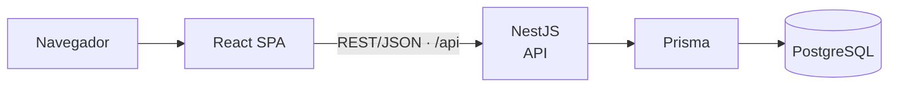
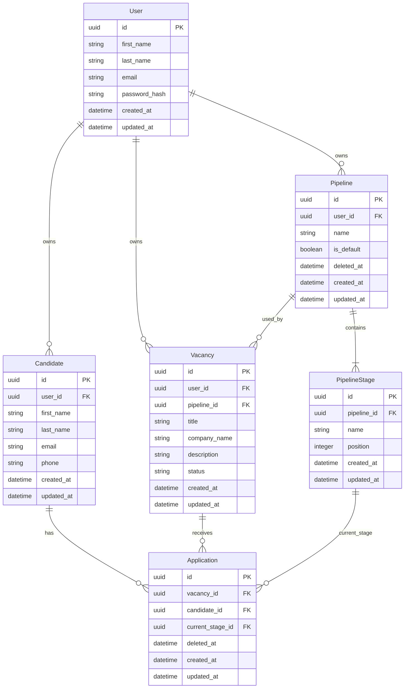

## Índice

0. [Ficha del proyecto](#0-ficha-del-proyecto)
1. [Descripción general del producto](#1-descripción-general-del-producto)
2. [Arquitectura del sistema](#2-arquitectura-del-sistema)
3. [Modelo de datos](#3-modelo-de-datos)
4. [Especificación de la API](#4-especificación-de-la-api)
5. [Historias de usuario](#5-historias-de-usuario)
6. [Tickets de trabajo](#6-tickets-de-trabajo)
7. [Pull requests](#7-pull-requests)

---

## 0. Ficha del proyecto

### **0.1. Tu nombre completo:**

Pablo Javier Samman

### **0.2. Nombre del proyecto:**

RecruitLane

### **0.3. Descripción breve del proyecto:**

RecruitLane es un MVP individual para que cada Recruiter gestione de forma aislada sus Candidates, Pipelines, Vacancies y Applications dentro de sus procesos de selección.

### **0.4. URL del proyecto:**

> Puede ser pública o privada, en cuyo caso deberás compartir los accesos de manera segura. Puedes enviarlos a [alvaro@lidr.co](mailto:alvaro@lidr.co) usando algún servicio como [onetimesecret](https://onetimesecret.com/).

### 0.5. URL o archivo comprimido del repositorio

https://github.com/epsilon886/AI4Devs-finalproject

---

## 1. Descripción general del producto

> Describe en detalle los siguientes aspectos del producto:

### **1.1. Objetivo:**

El objetivo de RecruitLane es proporcionar a cada Recruiter un espacio individual para organizar la información esencial de sus procesos de selección: su cartera de Candidates, las Vacancies que gestiona, los Pipelines asociados y la etapa actual de cada Application. El MVP busca centralizar este seguimiento con reglas explícitas de propiedad y de ciclo de vida, sin incorporar colaboración ni estructuras organizacionales.

### **1.2. Características y funcionalidades principales:**

Las principales funcionalidades del MVP son:

- **Acceso individual del Recruiter:** registro, inicio y cierre de sesión para operar en un espacio propio y aislado.
- **Gestión de Candidates:** creación, consulta y actualización de Candidates propios con sus datos mínimos; el correo es único dentro de la cartera de cada Recruiter.
- **Gestión de Pipelines:** creación de un Pipeline predeterminado `Default` para cada Recruiter, con sus PipelineStages iniciales, y gestión de Pipelines personalizados de entre tres y diez etapas. Un Pipeline personalizado solo puede editarse o eliminarse lógicamente antes de su primera asociación con una Vacancy; el predeterminado no se edita ni se elimina.
- **Gestión de Vacancies:** creación y consulta de Vacancies propias, cada una vinculada de forma permanente a un único Pipeline. Comienzan en `DRAFT` y siguen el ciclo de estados definido entre `DRAFT`, `OPEN`, `FILLED` y `CANCELLED`.
- **Gestión de Applications:** creación de una Application entre un Candidate y una Vacancy propios y abiertos, asignándola inicialmente a la primera PipelineStage. Mientras la Vacancy esté `OPEN`, la Application puede moverse entre las etapas de su Pipeline o eliminarse lógicamente.
- **Aislamiento y límites del MVP:** los recursos pertenecen a un único Recruiter y no pueden compartirse ni combinarse entre Recruiters. El alcance no incluye organizaciones, equipos, roles configurables, invitaciones, colaboración, automatizaciones o integraciones; tampoco incluye eliminación de Candidates o Vacancies, recuperación de recursos eliminados ni historial de movimientos entre PipelineStages.

### **1.3. Diseño y experiencia de usuario:**

> Proporciona imágenes y/o videotutorial mostrando la experiencia del usuario desde que aterriza en la aplicación, pasando por todas las funcionalidades principales.

### **1.4. Instrucciones de instalación:**
> Documenta de manera precisa las instrucciones para instalar y poner en marcha el proyecto en local (librerías, backend, frontend, servidor, base de datos, migraciones y semillas de datos, etc.)

---

## 2. Arquitectura del Sistema

### **2.1. Diagrama de arquitectura:**



La arquitectura V1 aprobada es un monolito modular: una SPA de React y una única aplicación NestJS organizada por módulos de dominio, sin microservicios ni comunicación distribuida. Es adecuada para el MVP porque mantiene límites claros entre responsabilidades sin añadir complejidad operativa o contratos innecesarios.

Sus beneficios principales son un desarrollo y despliegue más simples, una persistencia centralizada y una evolución gradual del producto. El trade-off frente a una arquitectura distribuida es que los componentes no se despliegan ni escalan de forma independiente; para el alcance actual, esa independencia no justifica su coste adicional.


### **2.2. Descripción de componentes principales:**

| Componente | Tecnologías principales | Responsabilidad |
| --- | --- | --- |
| Frontend | React, TypeScript y Vite | SPA prevista que presentará la interfaz y consumirá la API mediante rutas relativas `/api`. |
| API/backend | NestJS y REST/JSON | Aplicación modular prevista que concentrará las reglas de negocio y expondrá la API. |
| Persistencia | Prisma y PostgreSQL | Acceso a datos y almacenamiento relacional previstos para el MVP. |
| Workflow de desarrollo | Docker | Flujo oficial previsto para coordinar frontend, backend, PostgreSQL y migraciones. |

### **2.3. Descripción de alto nivel del proyecto y estructura de ficheros**

Actualmente el repositorio incluye los artefactos de documentación y OpenSpec, además de los directorios `front/` y `back/` del `pnpm workspace` vigente, con esta organización de alto nivel:

```text
front/    # SPA de React
back/     # API REST modular de NestJS y acceso Prisma
openspec/ # especificaciones y decisiones aprobadas
```

La organización prevista separa frontend y backend dentro de un único repositorio; el backend conserva el enfoque de monolito modular.

### **2.4. Infraestructura y despliegue**

Docker es el workflow oficial de desarrollo de V1. La composición prevista coordinará los componentes de frontend, backend y PostgreSQL, junto con una tarea de migraciones de ejecución única. La configuración concreta de Docker todavía no está definida.

El despliegue conceptual será de mismo origen: la SPA se servirá en la raíz HTTPS del host y las solicitudes a `/api` se enrutarán a NestJS. PostgreSQL permanecerá privado y no se expondrá públicamente. El proveedor de despliegue y el mecanismo concreto de proxy siguen pendientes de definición.

### **2.5. Seguridad**

> Enumera y describe las prácticas de seguridad principales que se han implementado en el proyecto, añadiendo ejemplos si procede

### **2.6. Tests**

> Describe brevemente algunos de los tests realizados

---

## 3. Modelo de Datos

### **3.1. Diagrama del modelo de datos:**

El siguiente diagrama describe el modelo lógico aprobado y sus convenciones físicas principales. La persistencia aprobada usa Prisma sobre PostgreSQL: los modelos Prisma se expresan en PascalCase con campos camelCase y se mapean a tablas plurales y columnas snake_case. Los tipos del diagrama son una representación documental simplificada de ese esquema físico.




### **3.2. Descripción de entidades principales:**

- **`User`**: representa la cuenta autenticada del Recruiter y funciona como propietario de candidatos, pipelines y vacantes, garantizando el aislamiento de recursos entre usuarios.

- **`Candidate`**: representa una persona candidata gestionada por un Recruiter. Puede participar en múltiples procesos de selección mediante distintas `Application`.

- **`Pipeline`**: define la estructura reutilizable de un proceso de selección. Pertenece a un Recruiter y está compuesto por etapas ordenadas; puede ser el pipeline predeterminado o uno personalizado.

- **`PipelineStage`**: representa una etapa ordenada dentro de un `Pipeline`, como Applied, Screening o Interview. Las `Application` utilizan una de estas etapas como posición actual dentro del proceso.

- **`Vacancy`**: representa una vacante gestionada por un Recruiter. Está asociada permanentemente a un único `Pipeline` y posee un ciclo de vida propio mediante los estados `DRAFT`, `OPEN`, `FILLED` y `CANCELLED`.

- **`Application`**: representa la participación de un `Candidate` en una `Vacancy`. Resuelve la relación N:N entre ambos y mantiene únicamente la etapa actual del candidato dentro del pipeline de esa vacante.

Las relaciones son: User 1:N Candidate, Pipeline y Vacancy; Pipeline 1:N PipelineStage y Vacancy; Candidate 1:N Application; Vacancy 1:N Application; y PipelineStage 1:N Application. La propiedad de Application se deriva de sus relaciones con Candidate y Vacancy, por lo que no tiene `user_id`.

**Restricciones físicas e invariantes de dominio:**

- Los identificadores son UUID v7 y las fechas se almacenan como `timestamptz` en UTC.
- Las claves foráneas protegen las relaciones con una política equivalente a `onDelete: Restrict`; no hay eliminaciones en cascada.
- `User.email` es único globalmente.
- `Candidate.email` es único dentro de su User propietario: `(user_id, email)`.
- El nombre normalizado de un Pipeline es único entre los Pipelines activos de un mismo User mediante un índice único parcial sobre `(user_id, name)` cuando `deleted_at IS NULL`; así puede reutilizarse tras una eliminación lógica.
- Cada User tiene exactamente un Pipeline predeterminado.
- El Pipeline predeterminado nunca puede editarse ni eliminarse.
- Un Pipeline personalizado contiene entre 3 y 10 PipelineStages ordenadas.
- Los nombres y las posiciones de PipelineStage son únicos dentro de su Pipeline: `(pipeline_id, name)` y `(pipeline_id, position)`.
- Cada Vacancy usa exactamente un Pipeline perteneciente al mismo User, y `Vacancy.pipeline_id` es inmutable tras crear la Vacancy.
- Un Pipeline personalizado solo puede editarse y eliminarse lógicamente antes de su primera asociación con una Vacancy; a partir de entonces es permanentemente inmutable y no eliminable. Su editabilidad se deriva de ese historial de uso; no existe un campo `editable`.
- Candidate y Vacancy vinculados por una Application deben pertenecer al mismo User.
- `Application.current_stage_id` debe referenciar una PipelineStage del mismo Pipeline asignado a su Vacancy.
- Solo puede existir una Application activa por combinación Candidate + Vacancy, garantizada mediante un índice único parcial sobre `(candidate_id, vacancy_id)` cuando `deleted_at IS NULL`. Una Application eliminada lógicamente deja de participar en esa unicidad.
- La eliminación lógica solo aplica a Pipeline y Application en el MVP; PipelineStage no usa eliminación lógica. La eliminación de Candidate y Vacancy no forma parte del MVP.

---

## 4. Especificación de la API

> Si tu backend se comunica a través de API, describe los endpoints principales (máximo 3) en formato OpenAPI. Opcionalmente puedes añadir un ejemplo de petición y de respuesta para mayor claridad

Los siguientes fragmentos usan el servidor base `/api` y referencian los schemas canónicos de `docs/openapi.yaml`.

```yaml
paths:
  /auth/register:
    post:
      summary: Registrar un Recruiter
      security: []
      parameters:
        - name: Origin
          in: header
          required: true
          description: Debe coincidir con el mismo origen de la aplicación.
          schema: { type: string }
        - name: X-CSRF-Protection
          in: header
          required: true
          schema: { type: string, const: '1' }
      requestBody:
        required: true
        content:
          application/json:
            schema:
              $ref: 'docs/openapi.yaml#/components/schemas/RegisterRequest'
      responses:
        '201':
          description: Cuenta creada; no inicia sesión.
          content:
            application/json:
              schema:
                $ref: 'docs/openapi.yaml#/components/schemas/RegistrationSuccess'

  /vacancies:
    post:
      summary: Crear una vacante
      security:
        - sessionCookie: []
      parameters:
        - name: Origin
          in: header
          required: true
          description: Debe coincidir con el mismo origen de la aplicación.
          schema: { type: string }
        - name: X-CSRF-Protection
          in: header
          required: true
          schema: { type: string, const: '1' }
      requestBody:
        required: true
        content:
          application/json:
            schema:
              $ref: 'docs/openapi.yaml#/components/schemas/VacancyCreateRequest'
      responses:
        '201':
          description: Vacante creada en estado `DRAFT`.
          content:
            application/json:
              schema:
                $ref: 'docs/openapi.yaml#/components/schemas/VacancyDetail'

  /applications/{id}:
    patch:
      summary: Mover una postulación a una stage
      security:
        - sessionCookie: []
      parameters:
        - name: id
          in: path
          required: true
          description: UUID de la Application.
          schema: { type: string, format: uuid }
        - name: Origin
          in: header
          required: true
          description: Debe coincidir con el mismo origen de la aplicación.
          schema: { type: string }
        - name: X-CSRF-Protection
          in: header
          required: true
          schema: { type: string, const: '1' }
      requestBody:
        required: true
        content:
          application/json:
            schema:
              $ref: 'docs/openapi.yaml#/components/schemas/ApplicationUpdateRequest'
      responses:
        '200':
          description: Detalle actual de la postulación, incluso para un movimiento no-op válido.
          content:
            application/json:
              schema:
                $ref: 'docs/openapi.yaml#/components/schemas/ApplicationDetail'
```

---

## 5. Historias de Usuario

> Documenta 3 de las historias de usuario principales utilizadas durante el desarrollo, teniendo en cuenta las buenas prácticas de producto al respecto.

**Historia de Usuario 1 — HU-01: Registrar Recruiter**

Como recruiter, quiero registrarme en RecruitLane, para acceder de forma segura a un espacio propio donde gestionar mis procesos de selección.

**Criterios de aceptación**

- **AC1 — Registro correcto:** Given que no existe un Recruiter registrado con el correo ingresado, When una persona completa el registro con nombre, apellido, correo y contraseña válidos, Then el sistema crea una nueva cuenta de Recruiter, sin iniciar sesión automáticamente, y la cuenta queda disponible para autenticarse.
- **AC2 — Correo duplicado:** Given que existe un Recruiter registrado con un determinado correo, When una persona intenta registrarse utilizando el mismo correo, Then el sistema rechaza el registro y no crea una segunda cuenta.
- **AC3 — Protección de contraseña:** Given que una persona completa correctamente el registro, When el sistema persiste las credenciales del Recruiter, Then la contraseña original no se almacena en texto plano.
- **AC4 — Pipeline inicial:** Given que una persona completa correctamente el registro, When se crea su cuenta de Recruiter, Then el sistema crea automáticamente el Pipeline predeterminado `Default` con las etapas Applied, Screening, Interview, Offer, Hired y Rejected en ese orden.

**Historia de Usuario 2 — HU-02: Crear una vacante**

Como recruiter, quiero crear una vacante y asignarle un pipeline de selección, para gestionar las postulaciones mediante un proceso definido.

**Criterios de aceptación**

- **AC1 — Pipelines disponibles:** Given que el Recruiter está autenticado y dispone de pipelines propios, When inicia la creación de una vacante, Then puede seleccionar uno de sus pipelines disponibles y no puede seleccionar pipelines pertenecientes a otro Recruiter.
- **AC2 — Creación correcta:** Given que el Recruiter está autenticado y seleccionó un pipeline propio, When crea una vacante con título, nombre de empresa y descripción válidos, Then el sistema crea la vacante asociada al pipeline seleccionado y queda inicialmente en estado `DRAFT`.
- **AC3 — Campos requeridos:** Given que el Recruiter está creando una vacante, When omite el título, el nombre de empresa o la descripción, Then el sistema rechaza la creación.
- **AC4 — Pipeline fijo:** Given que existe una vacante, When el Recruiter intenta sustituir su pipeline, Then el sistema rechaza la modificación.
- **AC5 — Inmutabilidad del pipeline utilizado:** Given que un pipeline personalizado fue asociado a una vacante, When el Recruiter intenta modificar su nombre o sus etapas, Then el sistema rechaza la modificación.

**Historia de Usuario 3 — HU-03: Mover una candidatura entre etapas**

Como recruiter, quiero mover una candidatura entre las etapas del pipeline de una vacante, para reflejar el avance del candidato dentro del proceso de selección.

**Criterios de aceptación**

- **AC1 — Movimiento válido:** Given que una Vacancy está en estado `OPEN` y contiene una Application activa, When el Recruiter mueve la Application a otra etapa del pipeline de la Vacancy, Then el sistema actualiza su etapa actual.
- **AC2 — Movimiento no consecutivo:** Given que una Application pertenece a una Vacancy `OPEN`, When el Recruiter selecciona una etapa no consecutiva del mismo pipeline, Then el sistema permite el movimiento.
- **AC3 — Etapa de otro pipeline:** Given que una Application pertenece a una Vacancy con un pipeline determinado, When el Recruiter intenta moverla a una etapa perteneciente a otro pipeline, Then el sistema rechaza el movimiento.
- **AC4 — Vacante no abierta:** Given que una Application pertenece a una Vacancy que no está `OPEN`, When el Recruiter intenta moverla, Then el sistema rechaza el movimiento y mantiene la Application en su etapa actual.
- **AC5 — Ownership:** Given que una Application pertenece a otro Recruiter, When el Recruiter autenticado intenta modificar su etapa, Then el sistema rechaza la operación y no expone ni modifica la Application.

---

## 6. Tickets de Trabajo

> Documenta 3 de los tickets de trabajo principales del desarrollo, uno de backend, uno de frontend, y uno de bases de datos. Da todo el detalle requerido para desarrollar la tarea de inicio a fin teniendo en cuenta las buenas prácticas al respecto. 

**Ticket 1 — Crear el esquema Prisma y la migración inicial de RecruitLane**

**Tipo:** Base de datos

**Objetivo**

Definir la persistencia relacional inicial del MVP en Prisma y PostgreSQL para las seis entidades aprobadas.

**Alcance**

Modelar `User`, `Candidate`, `Pipeline`, `PipelineStage`, `Vacancy` y `Application`, con sus campos, relaciones y mapeos físicos aprobados. Incluir identificadores UUID v7, fechas `timestamptz`, claves foráneas con comportamiento equivalente a `onDelete: Restrict`, y `deletedAt` únicamente en Pipeline y Application. Incorporar las unicidades de User, Candidate y PipelineStage, los índices únicos parciales de Pipeline activo y Application activa, y los índices iniciales de Vacancy y Application definidos en el diseño.

**Criterios de aceptación**

- AC1 — El esquema representa las seis entidades y sus relaciones aprobadas, con los campos y límites físicos definidos para cada una.
- AC2 — Las claves foráneas y las restricciones de unicidad protegen las relaciones y los datos propios de cada entidad sin eliminaciones en cascada.
- AC3 — La migración inicial incorpora el borrado lógico de Pipeline y Application y los índices únicos parciales sobre `(user_id, name)` y `(candidate_id, vacancy_id)` para los registros activos.

**Dependencias**

Decisión de arquitectura aprobada en la tarea 1.1 y modelo físico definido en `design.md`.

**Ticket 2 — Implementar el ciclo de vida de Vacancy**

**Tipo:** Backend

**Objetivo**

Permitir la actualización del estado de una Vacancy propia conforme al ciclo de vida aprobado.

**Alcance**

Implementar la lógica de actualización de `status` para una Vacancy propia. Debe admitir únicamente los estados `DRAFT`, `OPEN`, `FILLED` y `CANCELLED`, aplicar las transiciones permitidas y conservar el resultado actual cuando se solicita el mismo estado.

**Criterios de aceptación**

- AC1 — Se permiten exclusivamente las transiciones `DRAFT` a `OPEN`, `OPEN` a `FILLED`, `OPEN` a `CANCELLED`, `FILLED` a `OPEN` y `CANCELLED` a `OPEN`.
- AC2 — Cualquier transición distinta de las permitidas se rechaza.
- AC3 — Solicitar el estado actual es un no-op exitoso y conserva la representación actual de la Vacancy.

**Dependencias**

Estructura de backend y persistencia inicial (tarea 1.3), creación de Vacancies (tarea 4.1) y comprobación transversal de propiedad del Recruiter autenticado (tarea 2.3).

**Ticket 3 — Implementar el formulario de creación de Vacancy con selección de Pipeline propio**

**Tipo:** Frontend

**Objetivo**

Ofrecer al Recruiter un formulario para crear una Vacancy con los datos requeridos y un Pipeline propio disponible.

**Alcance**

Construir el formulario con título, nombre de empresa, descripción y selección de Pipeline. El formulario debe mostrar únicamente Pipelines propios disponibles, aplicar la validación de los campos conforme al contrato, y enviar la creación al contrato `POST /vacancies`. No define librería CSS, layout ni patrón visual.

**Criterios de aceptación**

- AC1 — El formulario permite ingresar título, nombre de empresa y descripción, y seleccionar un Pipeline propio disponible.
- AC2 — La ausencia de cualquiera de los campos requeridos o un valor que no cumple las reglas definidas por el contrato se informa en el formulario y no produce un envío válido.
- AC3 — Con datos válidos y un Pipeline propio seleccionado, el formulario envía la creación de la Vacancy y refleja el resultado de la operación.

**Dependencias**

Estructura de frontend y autenticación disponibles, consulta de Pipelines propios y contrato `POST /vacancies`; la creación de Vacancy y el aislamiento de propiedad se respaldan en las tareas 4.1 y 2.3.

---

## 7. Pull Requests

> Documenta 3 de las Pull Requests realizadas durante la ejecución del proyecto

**Pull Request 1**

**Pull Request 2**

**Pull Request 3**
